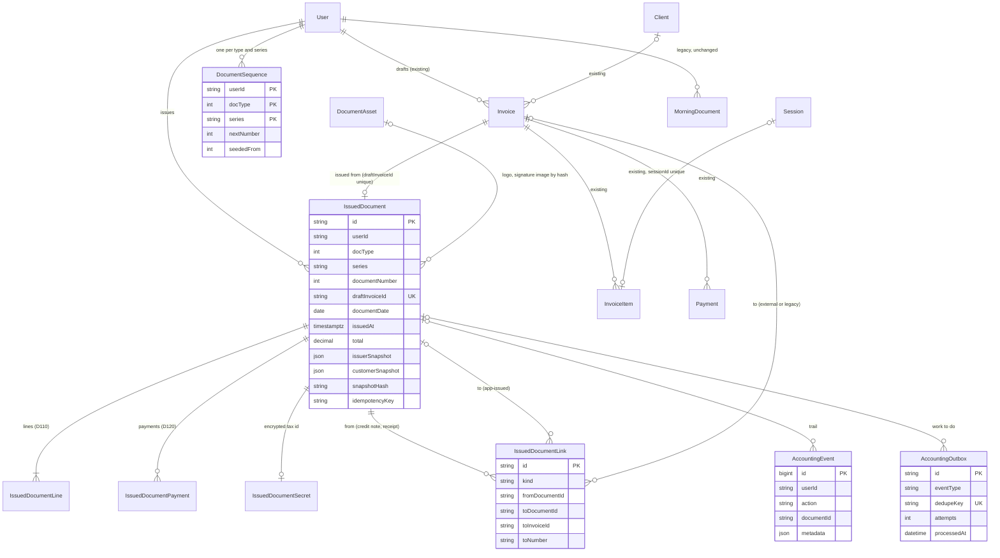

# Accounting module: data model (phase 1 proposal)

A proposal for review, **not a migration**. Nothing in `prisma/schema.prisma` changes in phase 0. Names follow the repo's conventions: PascalCase models, camelCase columns, `cuid()` ids, `userId` as the tenant, Decimal money.

Read with [current-architecture.md](current-architecture.md) (what exists) and [implementation-plan.md](implementation-plan.md) (in which PR each piece lands).

---

## 1. Decisions this model is built on

1. **The existing drafts stay the drafts.** A document is still prepared as an `Invoice` row with `docType` ("מסמך חדש", the form, the preview, `documentProblems`). Issuing copies it into new **write-once** tables. Nothing about drafts changes.
2. **"Issued" means "an `IssuedDocument` row exists for this draft".** There is no mutable status column on the issued record. Cancellation, payment and credit are separate link rows.
3. **The tenant is `User`.** The specification's `tax_businesses` is the `User` row; its details are copied into each document's issuer snapshot at issue time. No business table is added.
4. **Income keeps reading the draft rows.** After issue, the draft's money columns, items and payments are frozen by a trigger, so they can never diverge from the snapshot. That is how issued documents count exactly like recorded ones (section 7).
5. **One legal series per practice and type**, separate from `Invoice.number` (an internal row counter that drafts consume).
6. **Immutability is enforced by the database** (triggers in phase 1; privileges later), not only by the app.
7. **Ciphertext never sits in a write-once row**, because key rotation (`src/lib/reencrypt.ts`) rewrites ciphertext in place. Write-once rows hold plaintext hashes; ciphertext lives in a side table that only rotation may update.

---

## 2. How the specification's tables map

| Specification | This model | Note |
|---|---|---|
| `tax_businesses` | `User` + `issuerSnapshot` | Effective dating is by snapshot: a change of VAT status affects documents issued after it |
| `tax_document_sequences` | `DocumentSequence` | Seeded from `User.docNext*` on first issue |
| `tax_documents` | `IssuedDocument` (+ the `Invoice` draft it came from) | |
| `tax_document_lines` | `IssuedDocumentLine` | Uniform file D110 |
| `tax_receipt_payments` | `IssuedDocumentPayment` | Uniform file D120 |
| `tax_document_links` | `IssuedDocumentLink` | Credits and payments, to app-issued or external documents |
| `tax_audit_events` | `AccountingEvent` | Separate from the clinical `AuditLog` |
| `tax_outbox` | `AccountingOutbox` | |
| idempotency key | `IssuedDocument.idempotencyKey` + `requestHash`, and `draftInvoiceId` unique | No separate table in phase 1 |
| `tax_document_artifacts` | `IssuedDocumentArtifact` (phase 3) | Sketch in section 9 |
| `tax_authority_connections`, `tax_allocation_requests` | `TaxAuthorityConnection`, `AllocationRequest`, `AllocationNumber` (phase 6) | Sketch |
| `tax_uniform_exports` | `UniformExport` (phase 5) | Sketch |
| Status enum `DRAFT … ARTIFACT_FAILED` | DRAFT = `Invoice` with no `IssuedDocument`; ISSUED = row exists; artifact states = artifact and outbox rows; PENDING_ALLOCATION = `AllocationRequest` | No status is ever updated on a write-once row |

---

## 3. Entity diagram



---

## 4. Proposed Prisma models (phase 1)

```prisma
// ── Accounting: issued documents (write-once) ───────────────────────────────
// Rules: docs/accounting/data-model.md. Every table below except
// AccountingOutbox and the ciphertext column of IssuedDocumentSecret is
// protected by triggers: no UPDATE, DELETE or TRUNCATE.

/// One legal number series per practice, document type and series. Created in
/// the first issue transaction of that type, from User.docNext*. nextNumber
/// only ever goes up, by exactly the documents issued.
model DocumentSequence {
  userId     String
  user       User     @relation(fields: [userId], references: [id], onDelete: Restrict)
  docType    Int      // 400 | 320 | 305 | 330 (| 300 if confirmed)
  series     String   @default("MAIN")
  nextNumber Int      // the number the next issued document of this type gets
  seededFrom Int      // the User.docNext* value it started from (kept for the record)
  createdAt  DateTime @default(now())
  updatedAt  DateTime @updatedAt

  @@id([userId, docType, series])
}

/// An issued income document: the permanent record (קובץ קבוע). Never updated
/// or deleted. Rendered (preview, PDF, copies, uniform file) only from here.
model IssuedDocument {
  id             String   @id @default(cuid())
  userId         String
  user           User     @relation(fields: [userId], references: [id], onDelete: Restrict)
  docType        Int
  series         String   @default("MAIN")
  documentNumber Int

  /// The draft it was issued from. A draft is issued at most once.
  draftInvoiceId String   @unique
  draftInvoice   Invoice  @relation("IssuedFromDraft", fields: [draftInvoiceId], references: [id], onDelete: Restrict)

  documentDate   DateTime @db.Date         // printed date, clinic calendar
  issuedAt       DateTime @default(now())  // system time, never typed (II-10)
  actorUserId    String                    // who issued; today always userId
  clientId       String?                   // for lookups only, no FK: the snapshot is the record

  currency       String   @default("ILS")
  lang           String   @default("he")
  vatLiable      Boolean                   // the issuer's status at issue
  vatIncluded    Boolean
  vatRate        Decimal  @db.Decimal(5, 4) // 0 for an exempt business
  subtotal       Decimal  @db.Decimal(12, 2) // before VAT
  vatAmount      Decimal  @db.Decimal(12, 2)
  total          Decimal  @db.Decimal(12, 2)
  paymentsTotal  Decimal  @db.Decimal(12, 2)

  issuerSnapshot   Json    // section 5
  customerSnapshot Json    // without the tax id itself
  contentSnapshot  Json    // description, remarks, settings, referenced documents
  snapshotVersion  Int     // version of the canonical form
  snapshotHash     String  // sha256 of the canonical snapshot, tax id included
  templateVersion  String  // e.g. "classic@1": copies render with the same template
  rulesetVersion   String  // e.g. "il-2026-11": the validation rules applied
  softwareVersion  String  // git sha of the build that issued it

  idempotencyKey   String  // from the browser, one per "הפקה" attempt
  requestHash      String  // sha256 of the draft as submitted, to refuse key reuse
  retainUntilYear  Int     // tax year + 7 (conservative reading of RET-01); informational

  createdAt        DateTime @default(now())

  lines      IssuedDocumentLine[]
  payments   IssuedDocumentPayment[]
  secret     IssuedDocumentSecret?
  linksFrom  IssuedDocumentLink[] @relation("LinkFrom")
  linksTo    IssuedDocumentLink[] @relation("LinkTo")

  @@unique([userId, docType, series, documentNumber])
  @@unique([userId, idempotencyKey])
  @@unique([id, userId]) // target of the composite tenant FKs below
  @@index([userId, issuedAt])
  @@index([userId, docType, documentDate])
}

model IssuedDocumentLine {
  id          String   @id @default(cuid())
  documentId  String
  userId      String
  document    IssuedDocument @relation(fields: [documentId, userId], references: [id, userId], onDelete: Restrict)
  lineIndex   Int
  description String
  quantity    Decimal  @db.Decimal(12, 4)
  unitPrice   Decimal  @db.Decimal(12, 2)
  vatRate     Decimal  @db.Decimal(5, 4)
  lineTotal   Decimal  @db.Decimal(12, 2)
  sessionId   String?  // the meeting it bills; no FK (meetings can be deleted)

  @@unique([documentId, lineIndex])
}

model IssuedDocumentPayment {
  id            String        @id @default(cuid())
  documentId    String
  userId        String
  document      IssuedDocument @relation(fields: [documentId, userId], references: [id, userId], onDelete: Restrict)
  lineIndex     Int
  method        PaymentMethod
  paidOn        DateTime      @db.Date
  amount        Decimal       @db.Decimal(12, 2)
  bankName      String?
  bankBranch    String?
  bankAccount   String?
  chequeNumber  String?
  chequeDueDate DateTime?     @db.Date   // CON-R-08 (new on Payment too, PR 2.1)
  cardType      String?
  cardLast4     String?
  dealType      String?
  installments  Int?
  reference     String?
  details       String?

  @@unique([documentId, lineIndex])
}

/// A later document's tie to an earlier one: a credit note CREDITS, a receipt
/// PAYS. The target is an app-issued document or, for documents issued
/// elsewhere, the Invoice row that holds its recorded number.
model IssuedDocumentLink {
  id             String   @id @default(cuid())
  userId         String
  kind           String   // CREDITS | PAYS
  fromDocumentId String
  from           IssuedDocument @relation("LinkFrom", fields: [fromDocumentId, userId], references: [id, userId], onDelete: Restrict)
  toDocumentId   String?
  to             IssuedDocument? @relation("LinkTo", fields: [toDocumentId, userId], references: [id, userId], onDelete: Restrict)
  toInvoiceId    String?  // external or legacy document; no FK action beyond RESTRICT
  toDocType      Int      // as printed on the new document (CON-CN-02)
  toNumber       String
  toDate         DateTime @db.Date
  amount         Decimal  @db.Decimal(12, 2)
  createdAt      DateTime @default(now())

  @@index([userId, toDocumentId])
  @@index([userId, toInvoiceId])
}

/// The only ciphertext of an issued document. Rotation may rewrite the
/// ciphertext column; nothing else may change and nothing may be deleted.
model IssuedDocumentSecret {
  documentId              String @id
  userId                  String
  document                IssuedDocument @relation(fields: [documentId, userId], references: [id, userId], onDelete: Restrict)
  customerTaxIdCiphertext String?        // encryptSecret
}

/// Content-addressed images (logo, signature picture) referenced by hash from
/// issuer snapshots, so a later change in Settings never changes a document.
model DocumentAsset {
  sha256    String   @id
  mimeType  String   // image/png | image/jpeg
  dataUrl   String   @db.Text
  createdAt DateTime @default(now())
}

/// Append-only accounting trail, written in the same transaction as the change
/// it describes (unlike the best-effort AuditLog). No FK, so it outlives what
/// it describes. Metadata never holds names, tax ids, notes or line text.
model AccountingEvent {
  id          BigInt   @id @default(autoincrement())
  userId      String
  actorUserId String?
  action      String   // DOCUMENT_ISSUED | SEQUENCE_SEEDED | ISSUE_REPLAYED | NUMBERING_SETTING_CHANGED | ...
  documentId  String?
  invoiceId   String?
  metadata    Json     // type, number, totals, hashes, versions
  at          DateTime @default(now())

  @@index([userId, at])
  @@index([documentId])
}

/// Work that must happen after an issue commits (render, sign, deliver,
/// transmit). Written in the issue transaction; processed by the worker.
model AccountingOutbox {
  id          String    @id @default(cuid())
  userId      String
  eventType   String    // RENDER_ARTIFACT | DELIVER_EMAIL | TRANSMIT_UNIFORM | ...
  documentId  String?
  payload     Json      // ids only
  dedupeKey   String    @unique // e.g. "RENDER_ARTIFACT:<documentId>:classic@1"
  availableAt DateTime  @default(now())
  attempts    Int       @default(0)
  lockedUntil DateTime?
  lastError   String?   // one sanitised line
  processedAt DateTime?
  createdAt   DateTime  @default(now())

  @@index([processedAt, availableAt])
}
```

Changes to existing models in phase 1 (relation fields only, no new columns):
- `User`: `documentSequences DocumentSequence[]`, `issuedDocuments IssuedDocument[]`.
- `Invoice`: `issuedDocument IssuedDocument? @relation("IssuedFromDraft")`.

Added in phase 2 (PR 2.1), additive and nullable: `Invoice.docClientAddress` (CON-R-04, CON-TI-03) and `Payment.chequeDueDate` (CON-R-08). Phase 4 adds `Invoice.creditReason` (CON-CN-03) and a customer VAT number on 305/320 drafts.

SQL-only parts of the migration (Prisma can't express them): CHECK constraints (`docType IN (300,305,320,330,400)`, `nextNumber BETWEEN 1 AND 999999999`, `documentNumber BETWEEN 1 AND 999999999`, `kind IN ('CREDITS','PAYS')`, exactly one of `toDocumentId` / `toInvoiceId`, non-negative totals except where a credit note's sign convention says otherwise) and the triggers in section 6.

---

## 5. Snapshots

A snapshot is everything printed or needed to reprint, frozen at issue.

- **Issuer** (from `docBusiness` / `DOC_BUSINESS_SELECT`): business name, `businessId`, VAT status and its printed wording, address, phone, document email, website, occupation, description line; logo and signature picture by `DocumentAsset` hash (only if shown on documents); template and colour.
- **Customer**: `clientId` (lookup only), name as printed, address (phase 2), tax id (hashed into `snapshotHash`; the value itself only in `IssuedDocumentSecret`), the delivery emails.
- **Content**: description ("nature of the receipt"), remarks, currency, language, VAT type, rounding, VAT rate applied, referenced documents (type, number, date) for credit notes and receipts.
- Lines and payments are their own write-once tables, also covered by the hash.

**Canonical form** (pure function in `src/lib/accounting/snapshot.ts`, PR 1.5): keys sorted, no `undefined`, strings NFC-normalised, money as fixed two-decimal strings, dates as `yyyy-mm-dd`, lines and payments in `lineIndex` order. `snapshotHash = sha256(canonical)`. Verification decrypts the secret, rebuilds the canonical form from the rows and compares; a test does this for every issued document in the DB suites.

Copies, previews and the uniform file are produced **only** from the snapshot, never from `User`, `Client` or the draft.

---

## 6. Immutability in the database

### Triggers (phase 1, PR 1.4)

```sql
CREATE FUNCTION accounting_write_once() RETURNS trigger LANGUAGE plpgsql AS $$
BEGIN
  RAISE EXCEPTION 'accounting: % on % is not allowed (write-once record)', TG_OP, TG_TABLE_NAME
    USING ERRCODE = 'P0001';
END $$;

-- For each of IssuedDocument, IssuedDocumentLine, IssuedDocumentPayment,
-- IssuedDocumentLink, DocumentAsset, AccountingEvent:
CREATE TRIGGER <t>_no_change   BEFORE UPDATE OR DELETE ON "<t>" FOR EACH ROW       EXECUTE FUNCTION accounting_write_once();
CREATE TRIGGER <t>_no_truncate BEFORE TRUNCATE         ON "<t>" FOR EACH STATEMENT EXECUTE FUNCTION accounting_write_once();
```

Table-specific rules:
- `DocumentSequence`: no DELETE or TRUNCATE; UPDATE only if the key columns are unchanged and `NEW.nextNumber >= OLD.nextNumber`.
- `IssuedDocumentSecret`: UPDATE only of `customerTaxIdCiphertext` (key rotation); no DELETE or TRUNCATE.
- **Frozen drafts.** `Invoice`, BEFORE UPDATE: if an `IssuedDocument` exists with `draftInvoiceId = OLD.id`, refuse any change to the printed or money columns (`docType`, `clientId`, `issueDate`, `dueDate`, `subtotal`, `total`, `currency`, `lang`, `vatType`, `rounding`, `vatIncluded`, `docClient*` except the delivery email, `description`, `notes`, `relatedInvoiceId`, `morningDocId`, `morningDocNumber`). Still allowed: `status` and `amountPaid` (working state that credit notes and receipts move today), `draftSessionIds`, `updatedAt`.
- `InvoiceItem` of an issued draft: INSERT only with `linkOnly = true`; UPDATE only setting `sessionId` to NULL (what `applyCreditNote` does); no DELETE.
- `Payment` of an issued draft: no INSERT, UPDATE or DELETE. This also closes the `deletePaymentAction` hole for issued documents.
- `Invoice` and `User` deletes are already refused by the `RESTRICT` foreign keys from `IssuedDocument` and `DocumentSequence`.

### What triggers do and don't protect

Triggers stop the app's own code, and any query it runs by mistake, from changing an issued record. They do not stop someone holding the table owner's credential, who can `ALTER TABLE … DISABLE TRIGGER`. Today the app most likely connects as that owner (current-architecture §16). Two further layers:
- **Privileges (phase 7, PR 7.2):** a separate login role for the app with only `SELECT, INSERT` on write-once tables, and migrations run as the owner through a second connection string. This is an environment-variable change on Railway, so it needs Barak's approval.
- **Evidence:** `snapshotHash` on each document, hashes of artifacts (phase 3), the append-only `AccountingEvent`, the nightly backups, and later the quarterly Israeli backup.

**Schema changes later.** Triggers block data changes, not `ALTER TABLE`. A future migration that must backfill a column on a write-once table would have to disable the trigger inside that migration. That is the only escape hatch: it is visible in git, reviewed, and treated as a "new version" event (REG-11).

**Test harness.** `truncateAll` (`src/server/__tests__/db-harness.ts`) truncates every table and would hit the TRUNCATE triggers. PR 1.4 changes it to run inside `SET LOCAL session_replication_role = replica` (the CI and local test users are superusers; the harness already refuses any non-local database), and adds a test proving the triggers fire in normal mode.

---

## 7. Coexistence: issued, recorded and legacy documents

Three kinds of income document will live side by side:

| Kind | Where it lives | Counts as money because | Number |
|---|---|---|---|
| Legacy morning documents | `Invoice.morningDocId` (+ number, URL), `MorningDocument` rows | `morningDocId` set | morning's |
| Documents issued elsewhere, number recorded by hand | `Invoice.morningDocNumber`, session number fields | `morningDocNumber` set | the other system's |
| **Issued by the app** | `IssuedDocument` (+ its frozen draft) | an `IssuedDocument` exists for the draft | the app's `DocumentSequence` |

Rules:
1. **One predicate.** PR 1.1 replaces the 19 hand-written checks with `isIssuedDocument` / `ISSUED_DOCUMENT` (and their negations) in `src/lib/billing-docs.ts`. PR 1.6 adds one clause: `issuedDocument: { isNot: null }`. `COUNTS_AS_MONEY`, `UNISSUED_DOCUMENT` and the in-memory checks then cover app-issued documents with no other change.
2. **Same money, same source.** Income, open debt, credit-note refunds and reports keep reading the `Invoice` row and its `Payment` rows. Issuing performs the same side effects as recording a number does today: status DRAFT → SENT/PAID, `linkDraftSessions` (the issued number goes into the meeting's number field), and for a credit note `applyCreditNote` (original's working status CANCELLED, its meetings freed). The triggers then freeze the draft. **Totals cannot change because a document was issued rather than recorded.** A DB test (PR 1.6) issues one draft and records a number on an identical draft in a second practice, then compares `loadIncome`, `loadOpenDocuments`, `loadCreditNoteRefunds` and the reports' period summaries: they must be equal.
3. **A draft is either recorded or issued, never both.** Issue refuses a draft with `morningDocId` or `morningDocNumber`; `recordDocumentNumberAction` refuses a draft that has an `IssuedDocument` (and the trigger refuses the column change anyway).
4. **Numbers don't mix.** Uniqueness is enforced only within the app's own series. External numbers are strings from another system and are never checked against it. When the first issue of a type would start at or below the highest number recorded by hand for that type, the UI warns (it may be the same series continuing in two systems, question Q9).
5. **Links across systems.** A credit note or receipt issued in the app may point at a recorded or legacy document through `IssuedDocumentLink.toInvoiceId`, printing that document's number and date. Whether that is allowed is question Q18; until answered, phase 4 allows links only to app-issued documents.
6. **Uniform file.** Only app-issued documents go into the app's export. Whether external documents belong there is question Q19.
7. **Nothing legacy is rewritten.** `MorningDocument`, the morning columns and the session number fields keep their names and rows.

---

## 8. Numbering

### Starting point

The first issue of a type creates that type's `DocumentSequence` row from the corresponding `User.docNext*` setting (`NEXT_NUMBER_FIELDS` in `src/lib/document-look.ts`), inside the issue transaction. Before that, the settings card edits `User.docNext*` as today. From then on, the sequence is the source of truth: the card shows `DocumentSequence.nextNumber` read-only, and `updateDocumentNumberingAction` refuses to change a type that has a sequence (PR 1.8). Whether it may ever be raised afterwards (a gap) is question Q22.

### Allocation (inside the issue transaction)

```ts
// 1. Lock the practice row: serialises seeding against the settings card.
await tx.$queryRaw`SELECT id FROM "User" WHERE id = ${userId} FOR UPDATE`;

// 2. Seed once. The column name comes from a fixed map, never from input.
await tx.$executeRaw`
  INSERT INTO "DocumentSequence" ("userId","docType","series","nextNumber","seededFrom","createdAt","updatedAt")
  SELECT u.id, ${code}, 'MAIN', u.${Prisma.raw(`"${field}"`)}, u.${Prisma.raw(`"${field}"`)}, now(), now()
  FROM "User" u WHERE u.id = ${userId}
  ON CONFLICT DO NOTHING`;

// 3. Take the number. UPDATE … RETURNING holds the row lock until commit,
//    which is the same lock SELECT … FOR UPDATE would take.
const [{ n }] = await tx.$queryRaw<{ n: number }[]>`
  UPDATE "DocumentSequence" SET "nextNumber" = "nextNumber" + 1, "updatedAt" = now()
  WHERE "userId" = ${userId} AND "docType" = ${code} AND "series" = 'MAIN'
  RETURNING "nextNumber" - 1 AS n`;

// 4. Insert IssuedDocument with documentNumber = n, its lines, payments,
//    secret, links, the AccountingEvent and the outbox rows; freeze the draft.
```

The settings action takes the same `User` row lock before checking whether a sequence exists, so a settings save and a first issue can't interleave.

### Guarantees and how each is tested

| Guarantee | Mechanism | Test (PR 1.6) |
|---|---|---|
| No two documents share a number | Row lock on the sequence; unique `(userId, docType, series, documentNumber)` as a backstop | **100 parallel issues** of 100 drafts → numbers are exactly `start … start+99`, no duplicates, no gaps |
| No gaps from failures | The number is taken in the same transaction that inserts the document, so a rollback returns it | Force a failure after allocation → the next issue gets the same number; sequence check finds no gap |
| Never reused, never reset | Sequence only goes up (trigger); no DELETE; documents can't be deleted | Direct `UPDATE nextNumber = 1` and `DELETE` raise errors |
| Separate series per type | One row per `(userId, docType, series)` | Interleaved receipts and credit notes number independently |
| Practices are independent | `userId` in the key | Two practices issuing in parallel both start at their own settings |
| The same click never issues twice | `draftInvoiceId` unique; `(userId, idempotencyKey)` unique; same key with a different `requestHash` is refused | Retry with the same key returns the same document; 10 parallel calls with one key create one |

The specification's "tax year" wording (NUM-01, NUM-03) is met by never resetting: numbers run on across years. The `series` column exists so a clean series could be started later without touching the old one, if Q9 or Q22 says that is allowed.

---

## 9. Later-phase models (sketch only)

| Model | Phase | Purpose | Write-once? |
|---|---|---|---|
| `IssuedDocumentArtifact` | 3 | One rendered (and signed) PDF: document, template version, kind (ORIGINAL / COPY / COPY_WITH_ALLOCATION), plaintext sha256, size, signature metadata | yes |
| `IssuedDocumentArtifactBlob` | 3 | Encrypted bytes via `DocumentBlobStore`; rotation may rewrite | ciphertext only |
| `IssuedDocumentDelivery` | 3 | Each send or download: channel, original or copy, when, outcome (OC-01, OC-02) | yes |
| `RecipientConsent` | 3 | A client's consent to computerized documents, and withdrawals (ED-06) | yes |
| `UniformExport` | 5 | Period, spec version, primary id, file hashes, record counts, validation and transmission status | append-only status rows |
| `TaxAuthorityConnection` | 6 | Per practice: scopes, encrypted rotating tokens, expiry, revocation | no (tokens rotate) |
| `AllocationRequest`, `AllocationNumber` | 6 | Request state machine, idempotency, redacted payloads; the number granted, attached to a document without changing it (II-06, II-07) | requests no; numbers yes |

---

## 10. Retention and account closure

- Write-once tables have no deletion path in code and refuse deletes in the database.
- `retainUntilYear` records the conservative end of the retention period (RET-01). No job ever deletes issued documents; any future deletion after retention would be a separate, accountant-approved process.
- **Account closure today deletes invoices** (`purgeAccount`, `src/lib/account-closure-data.ts`). With issued documents present, the `RESTRICT` foreign keys make that transaction fail. PR 1.8 makes it explicit: `purgeAccount` skips an account that has issued documents, logs it once, and the closure screen and the operator's card say why. What happens to a departed therapist's permanent file is question Q13 for the lawyer, and the agreement and privacy policy will need to change before production issuing.
- `AccountingEvent` rows are not deleted on purge (unlike `AuditLog`).
- The account export (`src/lib/account-export.ts`) gains the issued documents, their lines and payments, and later their PDFs (PR 1.8, 3.1).
